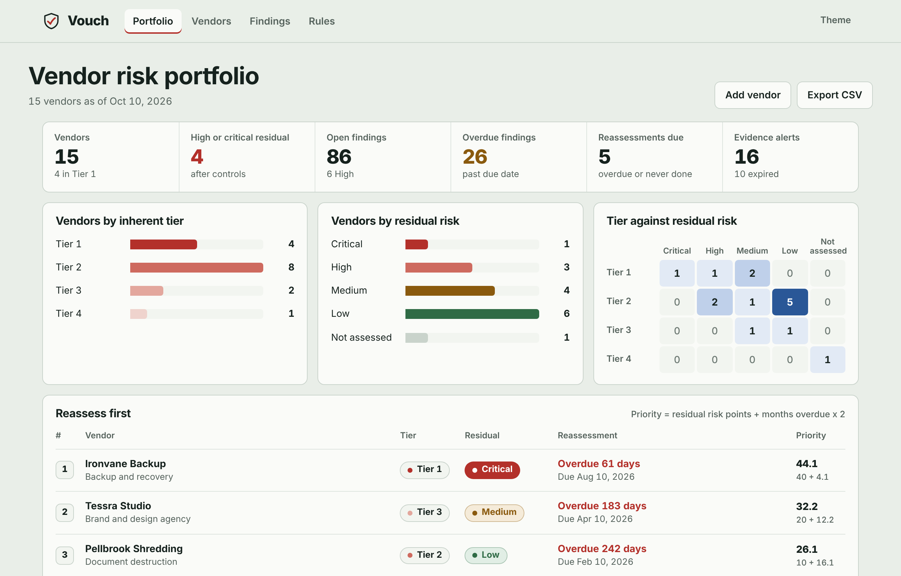
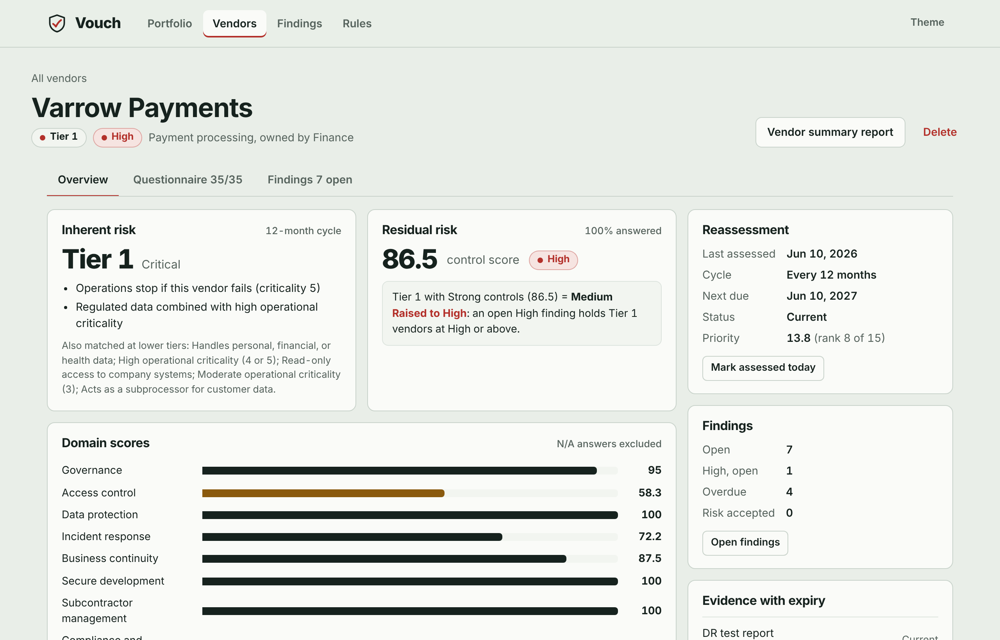
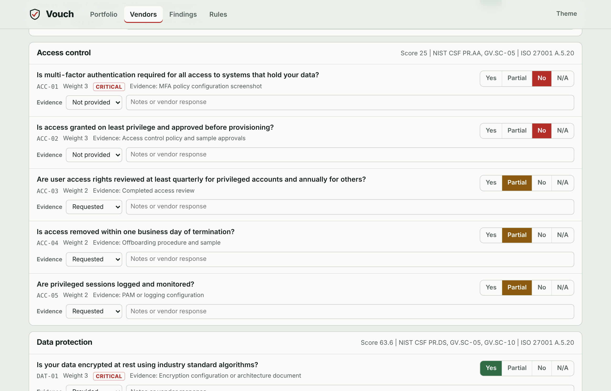
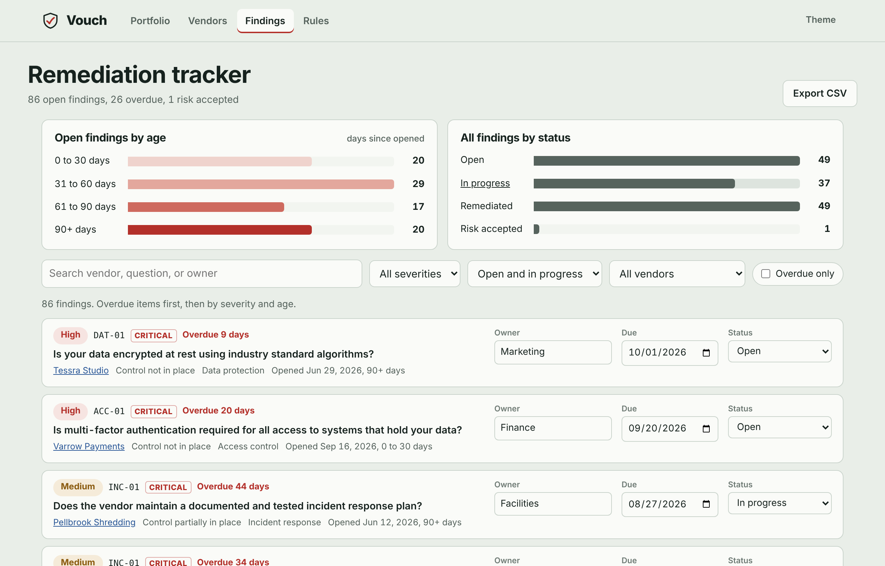
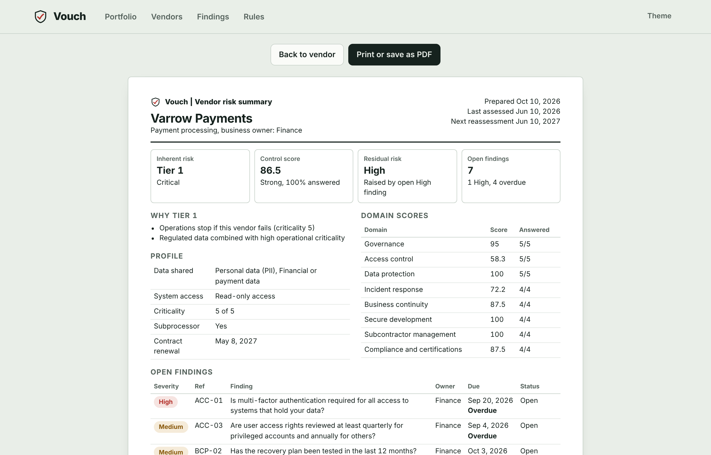

# Vouch

[](https://github.com/kaveryblake/vouch/actions/workflows/test.yml)

**Third-party risk assessments that show their work.** Vouch tiers each vendor by inherent risk, scores its security questionnaire, turns gaps into findings, and ranks the portfolio by which vendors to reassess first. Every rule it applies is visible in the app and editable in one file.

**Live demo:** https://kaveryblake.github.io/vouch/ (click "Open the sample portfolio")

Companion to [Tickmark](https://kaveryblake.github.io/tickmark/), which plans audit evidence for your own controls. Vouch covers the other side: the controls your vendors run on your behalf.



## Why I built it

Vendor risk reviews usually live in spreadsheets: a questionnaire tab, a findings tab, and a tiering formula nobody can explain six months later. The questions that matter to leadership are hard to answer from that setup. Which vendors carry the most residual risk? Whose SOC 2 report expired? Which reassessments are overdue? Vouch answers those from one source and shows the reasoning behind every rating.

## What it does

- **Vendor intake:** service, business owner, data shared (internal, personal, financial, health), system access level, operational criticality, subprocessor status, contract renewal, and last assessment date.
- **Inherent risk tiering:** Tier 1 to Tier 4 from a transparent rules table. Each vendor shows the exact rules that placed it, and the tier sets its reassessment cycle.
- **Questionnaire:** 35 original questions across 8 domains, answered Yes, Partial, No, or N/A. Each question carries a weight and a critical flag.
- **Scoring:** weighted scores per domain and overall, with N/A excluded from the denominator.
- **Findings:** generated automatically from No and Partial answers and from expired evidence, each with an owner, a due date based on severity, and a status.
- **Residual risk:** inherent tier combined with the control rating through a configurable matrix.
- **Evidence tracking:** status per answer (provided, requested, not provided) and expiry dates for SOC 2 reports, pen tests, DR tests, and insurance certificates, with alerts 90 days out.
- **Remediation tracker:** owners, due dates, aging buckets, overdue flags, and risk acceptance with justification, approver, and expiry. An expired acceptance reopens the finding.
- **Portfolio dashboard:** vendors by tier and residual risk, a tier against residual risk matrix, overdue findings, expiring evidence, upcoming renewals, and a ranked reassess-first list.
- **Reports:** a one-page vendor summary that prints cleanly or saves as PDF, plus CSV exports of the portfolio and the findings register.

| Vendor detail | Questionnaire |
|---|---|
|  |  |

| Remediation tracker | One-page vendor report |
|---|---|
|  |  |

## Methodology

Vouch follows the standard third-party risk life cycle: tier by inherent risk, assess controls, derive residual risk, remediate, and reassess on a cadence set by the tier.

### 1. Inherent risk tier

Inherent risk is the exposure a vendor represents before considering its controls. It comes from four intake factors: the data it handles, the access it has, how much operations depend on it, and whether it processes customer data as a subprocessor.

Each rule in the table lists conditions that must all be true. A vendor gets the most severe tier among every rule it matches, and the matching rules at that tier become the stated reason. A vendor that matches nothing falls to Tier 4.

| Tier | Example triggers | Reassess every |
|---|---|---|
| 1, Critical | Privileged access to sensitive data; criticality 5; financial or health data with criticality 4+ | 12 months |
| 2, High | Personal, financial, or health data; privileged access; criticality 4+ | 18 months |
| 3, Moderate | Internal data; read-only access; criticality 3; subprocessor | 24 months |
| 4, Low | None of the above | 36 months |

### 2. Control score

Each answer earns a share of its question's weight: Yes 100%, Partial 50%, No 0%. N/A and unanswered questions are excluded from the denominator, so a courier is not penalized for having no software development program. The overall score is weighted across all answered questions, not an average of domain averages.

| Band | Score |
|---|---|
| Strong | 85 to 100 |
| Adequate | 70 to 84.9 |
| Weak | 50 to 69.9 |
| Deficient | below 50 |

### 3. Residual risk

| Tier | Strong | Adequate | Weak | Deficient |
|---|---|---|---|---|
| Tier 1 | Medium | High | Critical | Critical |
| Tier 2 | Low | Medium | High | Critical |
| Tier 3 | Low | Low | Medium | High |
| Tier 4 | Low | Low | Low | Medium |

One override keeps a strong average from hiding a serious gap: **an open High finding holds Tier 1 and Tier 2 vendors at High residual risk or above.** In the sample portfolio, Varrow Payments scores 86.5 (Strong), which the matrix rates Medium for a Tier 1 vendor. Its missing MFA for portal users is a critical control gap, so it stays at High until that finding is remediated or formally accepted.

### 4. Findings and remediation

| Trigger | Severity | Due in |
|---|---|---|
| Critical question answered No | High | 30 days |
| Any other No or Partial | Medium | 90 days |
| Dated evidence past its expiry | Low | 180 days |

Findings are derived from the answers, so changing an answer to Yes closes the gap automatically. Owner, due date, status, and acceptance details persist by finding ID. A risk acceptance requires a justification, an approver, and an expiry date. When the acceptance expires, the finding reopens and counts toward residual risk again.

### 5. Reassess-first priority

```
priority = residual risk points + (months overdue x 2)
residual points: Critical 40, High 30, Medium 20, Low 10, Not assessed 25
months overdue is capped at 24 and floored at -12 (not yet due)
```

Residual risk sets the baseline, and time past the reassessment due date pushes a vendor up the list. A Low-risk vendor two years overdue can outrank a Medium-risk vendor that is current, which matches how stale assessments lose their value.

## Framework alignment

Vouch is a working model of a third-party risk program. It does not implement or certify compliance with any specific regulation. The questionnaire domains align to these supplier-risk outcomes and controls:

| Domain | NIST CSF 2.0 | ISO/IEC 27001:2022 |
|---|---|---|
| Governance | GV.PO, GV.RR, GV.SC-05 | A.5.19 Information security in supplier relationships |
| Access control | PR.AA, GV.SC-05 | A.5.20 Addressing information security within supplier agreements |
| Data protection | PR.DS, GV.SC-05, GV.SC-10 | A.5.20 |
| Incident response | RS.MA, GV.SC-08 | A.5.20, A.5.22 |
| Business continuity | RC.RP, GV.SC-08 | A.5.20 |
| Secure development | PR.PS-06, GV.SC-05 | A.5.20, A.5.21 Managing information security in the ICT supply chain |
| Subcontractor management | GV.SC-07 | A.5.21 |
| Compliance and certifications | GV.SC-07, ID.IM-01 | A.5.22 Monitoring, review and change management of supplier services |

At the program level, inherent tiering supports GV.SC-04 (suppliers known and prioritized by criticality), the questionnaire and scoring support GV.SC-06 and GV.SC-07 (due diligence and ongoing risk assessment), and the reassessment cadence supports A.5.22 (regular monitoring and review).

## Customizing the rules

Every rule lives in [`config.js`](config.js): tier rules, cadences, the 35 questions and their weights, control bands, the residual matrix, the High-finding floor, finding severities, remediation SLAs, aging buckets, alert windows, and the priority formula. Edit a value and both the app and the tests follow it. The Rules page in the app renders the live configuration, and `validateConfig` flags mistakes such as a residual matrix missing a tier.

## Tests

The scoring engine is a pure module with no DOM and no clock, so it runs under Node with a fixed date. There are 42 tests covering tiering rules, scoring math and N/A handling, band boundaries, finding generation, residual risk and the High-finding floor, evidence expiry, risk acceptance expiry, reassessment dates, priority ranking, and CSV escaping.

```
node --test
```

No dependencies to install. GitHub Actions runs the suite on every push.

## Project structure

```
index.html        Page shell and navigation
styles.css        Layout, light and dark themes, print styles for the report
config.js         Every rule and the questionnaire (edit here)
engine.js         Tiering, scoring, findings, residual risk, priority (pure functions)
sample-data.js    15 fictional vendors, generated relative to today
app.js            Views, routing, forms, exports
tests/            node --test suite for the engine
```

Plain HTML, CSS, and JavaScript. No framework, no build step, no backend. It runs on GitHub Pages or straight from the file system, and the portfolio is stored in the browser's local storage, so no vendor data leaves the user's machine.

## Notes

All vendors in the sample portfolio are fictional. Any resemblance to a real company is unintended. The questionnaire is original and not derived from any commercial questionnaire.

## Author

**Keenan Blake**, IT Risk and Compliance. See also [Tickmark](https://github.com/kaveryblake/tickmark), an audit evidence planner for seven frameworks.
